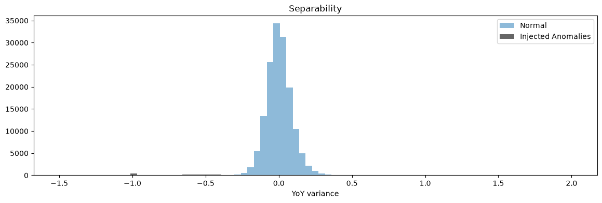

# Warehouse Inventory Discrepancy Year Over Year Analysis Demonstration
## Genesis of the Code
This project originated from an issue of too many cycle count errors over the course of a year.  I compiled some data and got to work, bringing in metrics from machine learning (notably: F1, Recall, and Precision, all of which are explained in the notebook), deciphering how to focus our efforts to clear those very same cycle counts.  Everything, essentially, boils down to one histogram, which acts as the gatekeeper.  If this histogram shows a separation between the normal rows and the anomalous, we're in business.

Since there is a clear divide in the anomalies on the left (very close to the axis) and the main data clustered around zero, this dataset is a green light to continue to the rest of the code.

## Requirements to Begin

### Library installation
In order to have all of the necessary libraries, you can simply run **pip install -r requirements.txt** in your terminal.  Looking through the requirements, you will notice that openai is optional as I have built a section of the code to run explanations *without* the use of an LLM, but if you have an API key and a higher quota than I opted for in this demo, you can absolutely run the code live with an LLM.

### LLM Setup
In the same path that you put the notebook and requirements.txt file, create a file named ***exactly*** .env and in that file, you need to set up the following four lines:

LLM_API_KEY= 

LLM_PROVIDER=openai 

LLM_BASE_URL=https://api.openai.com/v1 

LLM_MODEL=gpt-4o-mini

I have filled in the necessary baseline information (excluding your API key, of course) for you to use gpt 4o mini.  If you have a different OpenAI LLM that you prefer more, then you can change these parameters to match your preferred LLM to run the notebook live.  Otherwise, leave this section blank and the entire notebook will run in mock mode.

### Running the Notebook
To run the notebook, after completing the previous two steps, open the .ipynb file in VS Code (Python extension highly recommended) or Jupyter Lab and simply execute the cells in order!

## Workflow
The cells in this notebook are generally separated by each category:

### Generation:
First I generate synthetic data based on a seeded random generator so that the numbers always match (seed value 50).

### Injection:
Next I created some conditions of common inventory errors to then inject across a subset of rows in the synthetic data.

### Detection:
Next I created the code to sift through the data to detect any anomalies based on generic parameters gleaned from the histogram.  From there, I created some metrics formula to test how well the parameters really worked.  From there, it's simply refining the parameters.

### Refinement:
Between comparing the metrics and creating heat maps to quickly identify how well the parameters do, I was able to identify where I should start refining my parameter searches.  This was done through a sweeper function that crossed the all three parameters against each other and calculated the metrics for each set of data.

### Narration:
Here, the hard part is finished.  The refinement is done, the data is gathered, but how do we get it to the frontline employee in a way that won't have them trying to parse data that they don't look at daily?  That's where we ping an LLM to do exactly that.  Here, you grab the API key to your favorite LLM, plug in all the necessary models and provider details, and send her off!  Soon, you'll have the finished product: the exported CSV file!

### Export:
The export is the final product!  We compile the explanations from the return .json file and compile it into the table since we told the LLM to index it based on row number.  This will give a quick overview of what the SKU is, where it is, what the discrepancy is, and what the likely cause was. The file is set to write in the current working directory, you only need to look as far as where the files are.

## Design Notes
This could have easily been a run-of-the-mill modular .py repo, but instead I opted for a notebook instead.  This is for the main reason that this is just a linear demonstration of how I went about finding and correcting cycle count discrepancies.  It just made more sense to compile it into a single notebook than a modular file.

Additionally, since I went with an F1 metric (harmonic mean, think percentage of how well things work together), there are some blind spots in the data detection.  Namely, items with a naturally low inventory count, but a high cost.  Those discrepancies will be missed by this sweep; however, also adding an additional detection method of price will add those back in.  For simplicity sake, I did not also add in cost values in this demo.

## Results
The histograms, heat maps, the narrated LLM tables (or mock in lieu of LLM) all tell the story of the data.  What I accomplished in this demonstration is shining a light on the story and walked you through what the data was telling us from the beginning.

## License
MIT License
